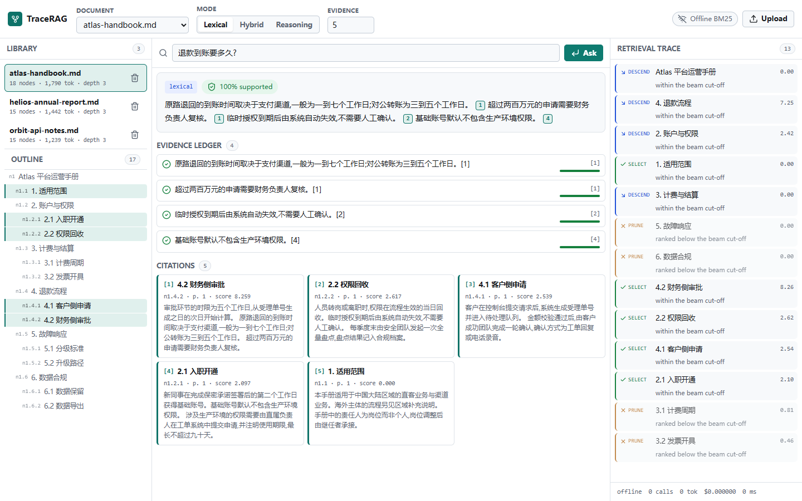

# TraceRAG

[](https://github.com/Supereggcat/tracerag/actions/workflows/tests.yml)

**不用向量库的检索增强生成,把每一步推理都摊开给你看。**

TraceRAG 把一份文档解析成章节树,让模型像人翻目录一样逐层推理找到相关段落,然后把三样东西一起交给你:
答案、带编号的引用来源、以及检索过程中每一个候选章节的取舍记录。最后它还会把自己的答案逐句拿回去
和引用原文核对,对不上的句子直接标出来,而不是默认可信。

没有向量数据库,没有 embedding 模型,也不做无脑切块。**不配任何 API Key 也能端到端跑通**,配上模型之后效果更好。



## 为什么不用向量检索

相似不等于相关。一个问"为什么退款这么慢"的问题,和一段讲退款 SLA 的正文,词汇高度重合;而真正能
回答它的那个段落,可能一个字都对不上。向量检索优化的恰恰是前者,后者会被静默丢掉。

这个项目的赌注是:**文档本身的结构已经编码了大部分你需要的信息**。像 `6.1 数据保留` 这样的标题,
是人写给"哪些问题应该在这一节回答"的标签。如果检索读的是结构,而不是把它切碎成等长的窗口,那么
即使正文换了完全不同的措辞,它也能找对地方。

## 和常见做法有什么不同

- **可审计的检索轨迹。** 每个被考虑过的候选章节都记录了得分、打分器、以及"保留还是剪枝"的理由。
  轨迹随答案一起返回,答错了可以直接读决策过程,而不是去猜向量空间里发生了什么。
- **逐句证据台账。** 答案写完之后,每个句子都会拿回它引用的原文核对。没有引用,或者和引用原文
  重合度过低的句子,会被标记出来,而不是默认可信。
- **混合路由,且能降级到离线。** 纯 Python 的 BM25 先对每一层做初筛,模型只看一份短名单,
  永远看不到整个语料。没有配 API Key 时模型环节直接跳过,系统照样能给出带引用的、确定性的答案。
- **结构感知的证据打包。** 检索到的章节按 token 预算装进上下文,送进去的是带标题的完整小节,
  而不是切碎的片段。
- **内置评测擂台。** 同一份语料、同一个打分器,树推理和平铺固定窗口切分正面对比,结论是**测出来的**,
  不是声称的。
- **按次计费与成本核算。** 每次查询的 token 和费用都会统计。

## 基准测试

完全离线运行(不配模型),所以结果免费、可复现(`tracerag eval --mode lexical`,24 道题,3 篇文档,`top_k=5`):

| 指标 | 树推理 | 朴素切分 |
| --- | ---: | ---: |
| recall@5(全部 24 题) | **95.8%** | 37.5% |
| recall@5(6 道多跳题) | **83.3%** | 33.3% |
| 送进答案模型的证据 token | **663** | 798 |
| 引用支持率 | 100% | n/a |
| 平均访问节点数 | 13.0 | n/a |
| 平均延迟 | <1 ms | n/a |

这张表要配上它该有的前提来读。`data/corpus` 里的语料是合成的,而且是**故意**构造成"标题承载语义、
正文换用不同措辞"——这在手册、年报、API 文档里非常常见,也正是平铺相似度检索最不擅长的场景。
它是一次针对单一失效模式的严谨测量,不是"树推理在所有场景都赢"的结论。

基线也没有被做手脚:它保留了标题行,而且一个跨越章节边界的窗口,只要部分覆盖了目标章节,就算它命中。

离线时"引用支持率 100%"的原因很无聊:离线回答是逐字引用原文的,所以台账实际上是在校验引文与出处。
配上模型之后这个数字才有真正的意义,因为那时台账审计的是模型生成的文字。

## 一次查询是怎么走的

```
                       构建一次                          查询时
  文件 ──► 解析 ──► 章节树 ──► index.json
                    (层级结构)                        问题
                                         │               │
                                         │               ▼
                                         │      ┌─────────────────┐
                                         │      │  BM25 逐层初筛   │
                                         │      └────────┬────────┘
                                         │               ▼
                                         │      ┌─────────────────┐
                                         └─────►│  模型筛短名单    │  可选
                                                └────────┬────────┘
                                                         ▼
                                                  选中的章节证据
                                                         │
                                                         ▼
                      答案 + [n] 引用标记 ◄──── 答案生成(模型或抽取式)
                                                         │
                                                         ▼
                                            证据台账逐句审计
```

1. **解析。** 遍历源文件,记录每一段文字当时处于哪条大纲路径下。Markdown 标题、数字编号标题、
   中文"第 X 章/节"、以及 PDF 提取文本里"短、无标点、像标题"的行都能识别。标题被当作结构消费掉,
   不会混进正文。
2. **建树。** 把大纲路径组装成树,分配稳定的层级 id(`n1`、`n1.2`、`n1.2.3`),并把超过 4000 字符的
   小节拆成子窗口,保证叶子节点仍然足够细。
3. **路由。** 每一层的候选先用 BM25 按 `标题 + 摘要` 排序,保留一个 beam,可选地让模型再筛一遍。
   父节点的分数会向下传递,所以一个强分支能把它下面得分较弱的子节点一起带进视野。
4. **作答。** 把留下的章节按 token 预算装进上下文,让模型写出带 `[n]` 标记的答案;没有 Key 时改为
   抽取最匹配的原文句子。
5. **审计。** 把答案切成句子,把每个 `[n]` 标记绑定到它真正支持的那一句,再逐句和引用章节的原文比对。

### 三种模式

| 模式 | 路由 | 作答 | 需要 Key |
| --- | --- | --- | --- |
| `lexical` | 只用 BM25 | 抽取式 | 不需要 |
| `hybrid` | BM25 + 模型筛短名单 | 模型,失败回退抽取式 | 不需要 |
| `reasoning` | 模型看到每一层的全部候选 | 模型,失败回退抽取式 | 不需要 |

三种模式都能离线跑通。`hybrid` 和 `reasoning` 在没有 Key 时只是做得少一点,不会报错。

## 快速开始

```bash
git clone https://github.com/Supereggcat/tracerag
cd tracerag
python -m venv .venv

# Windows
.venv\Scripts\activate
# macOS / Linux
source .venv/bin/activate

pip install -e ".[server,dev]"
```

索引自带语料并提问,不需要任何 API Key:

```bash
tracerag index data/corpus
tracerag docs
tracerag ask "退款到账要多久?" --doc atlas-handbook-656d6142 --trace
```

跑一遍评测:

```bash
tracerag eval --mode lexical
tracerag eval --mode lexical --json
```

启动网页界面:

```bash
tracerag serve --port 8011
# 然后打开 http://127.0.0.1:8011
```

### 接入大模型

任何兼容 OpenAI `/chat/completions` 协议的服务都可以用。离线模式不需要配置任何东西。

```bash
# OpenAI
export TRACERAG_API_KEY=sk-...
export TRACERAG_MODEL=gpt-4o-mini

# DeepSeek、Moonshot、通义千问、OpenRouter、vLLM、Ollama ...
export TRACERAG_API_KEY=...
export TRACERAG_BASE_URL=https://api.deepseek.com/v1
export TRACERAG_MODEL=deepseek-chat

tracerag ask "What protects me from a duplicate charge?" --doc orbit-api-notes-ddf28c68 --mode reasoning
```

`OPENAI_API_KEY`、`OPENAI_BASE_URL`、`OPENAI_MODEL` 可以作为兜底配置。网页界面顶栏会显示当前生效的模型,
没配模型时显示 `Offline BM25`。

## 命令行

```
tracerag index <paths...>      解析并索引文件或目录
tracerag docs                  列出已索引的文档
tracerag rm <doc_id>           删除一篇文档
tracerag ask "<question>"      针对单篇文档提问
    --doc <doc_id>             必填
    --mode lexical|hybrid|reasoning
    --top-k <n>                保留的证据小节数(默认 5)
    --trace                    打印完整检索轨迹
    --json                     输出机器可读格式
tracerag eval                  与平铺基线对比打分
    --cases <file>             默认 eval/questions.jsonl
    --mode, --top-k, --json
tracerag serve                 启动网页界面
    --host, --port, --reload
```

## HTTP 接口

| 方法 | 路径 | 用途 |
| --- | --- | --- |
| `GET` | `/api/health` | 运行状态、当前模型、已索引文档数 |
| `GET` | `/api/config` | 是否配置了模型、可用模式 |
| `GET` | `/api/docs` | 列出已索引文档 |
| `POST` | `/api/docs` | 上传并索引文档(multipart) |
| `GET` | `/api/docs/{id}` | 文档元信息与大纲 |
| `GET` | `/api/docs/{id}/tree` | 完整章节树 |
| `DELETE` | `/api/docs/{id}` | 删除文档 |
| `POST` | `/api/query` | 提问,返回答案 + 台账 + 轨迹 + 用量 |

```bash
curl -s localhost:8011/api/query \
  -H 'Content-Type: application/json' \
  -d '{"question":"退款到账要多久?","doc_id":"atlas-handbook-656d6142","mode":"hybrid","top_k":5}'
```

## 作为 Python 库

```python
from tracerag import Corpus, RetrievalConfig, ask, index_path

index_path("data/corpus", data_dir="data/index")
doc_id = Corpus("data/index").list_docs()[0].doc_id

answer = ask(
    "退款到账要多久?",
    doc_id,
    data_dir="data/index",
    config=RetrievalConfig(mode="lexical", max_selected=5),
)

print(answer.text)
print(f"支持率: {answer.supported_ratio:.0%}")
for entry in answer.ledger:
    print(entry.supported, entry.support, entry.sentence)
for step in answer.trace:
    print(step.decision, step.node_id, round(step.score, 3), step.rationale)
```

## 支持的文件格式

Markdown、纯文本、reStructuredText、HTML、PDF。PDF 依赖 `pypdf`,属于核心依赖。扫描版 PDF 需要先做 OCR,
本项目不包含 OCR。

## 测试

```bash
pytest
```

33 个用例,覆盖分词、大纲识别、树构建与 id 稳定性、长小节切窗、三种模式的检索、模型不可达时的优雅降级、
上下文预算、台账审计、语料持久化、HTTP 接口以及评测流程。

## 目录结构

```
src/tracerag/
  models.py      跨模块共享的类型定义
  text.py        中英文分词、句子切分、token 估算
  ingest.py      文件 -> 带大纲路径的文本块
  tree.py        文本块 -> 章节树
  lexical.py     零依赖 BM25
  llm.py         基于 urllib 的 OpenAI 兼容客户端
  retrieve.py    树推理检索器与检索轨迹
  answer.py      答案生成与证据台账
  store.py       磁盘语料存储
  pipeline.py    index_file / index_path / ask
  evaluate.py    树推理 vs 平铺切分
  baseline.py    平铺切分基线
  webapp.py      FastAPI 应用
  cli.py         命令行入口
web/             免构建的网页界面
data/corpus/     三篇示例文档
eval/            24 道评测题
```

## 致谢

- "用层级文档树 + 模型推理导航来替代相似度索引"这个思路,由 **PageIndex**
  (<https://github.com/VectifyAI/PageIndex>,MIT,Copyright (c) 2025 Vectify AI)推广开来。
  本项目是独立重写,架构和功能集都不同,没有复制任何源代码。详见 [NOTICE](NOTICE)。
- 网页界面的图标使用了 [Lucide](https://lucide.dev)(ISC 协议)。

## 许可证

MIT,详见 [LICENSE](LICENSE)。
